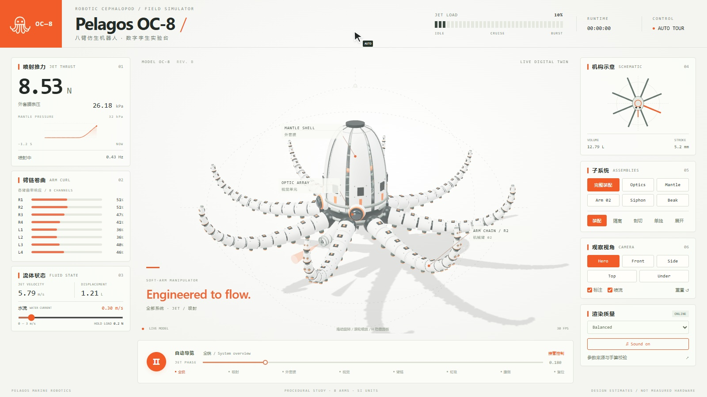
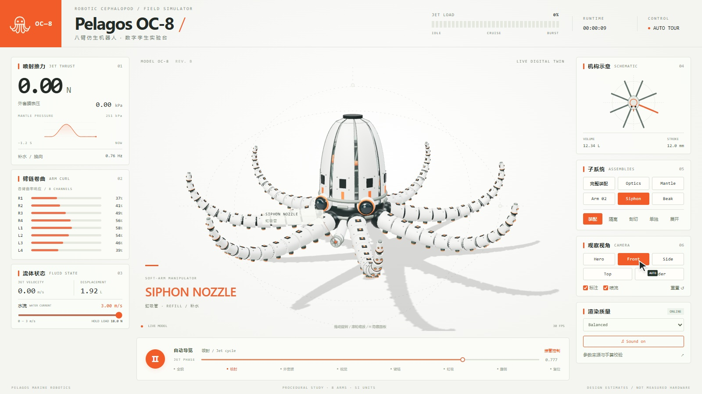
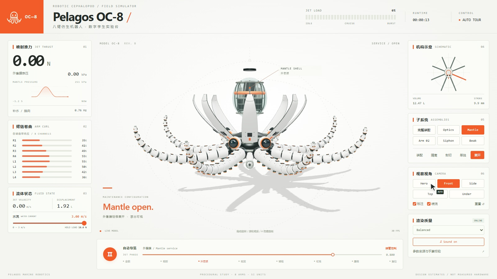
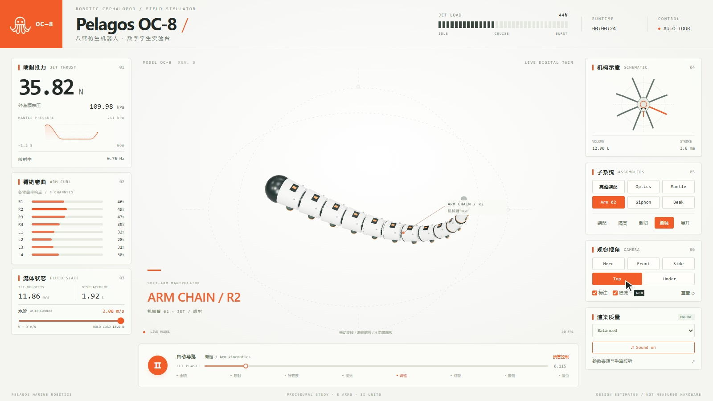
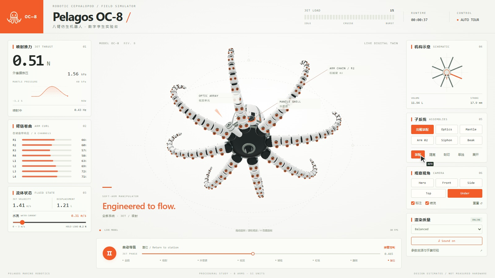

# Pelagos OC-8

**English** | [中文](README.zh-CN.md)

[](https://github.com/5758703/robotic_Pelagos_oc_8/stargazers)
[](LICENSE)
[](https://vuejs.org/)
[](https://threejs.org/)
[](https://vitejs.dev/)

Interactive digital twin of an eight-arm robotic octopus — Vue + Vite + Three.js.  
All physical parameters are **design estimates / my guess**; there is no live telemetry from a real vehicle.

<p align="center">
  
</p>

---

## Demo film

40-second scored console tour · 1600×900 · 30 FPS · mastered to ≈ −14 LUFS.

### Scored film (with audio)

<video src="artifacts/film/Pelagos_OC8_scored.mp4" controls width="860" poster="artifacts/film/frame-0.jpg">
  Your browser does not support embedded video.
  <a href="artifacts/film/Pelagos_OC8_scored.mp4">Download Pelagos_OC8_scored.mp4</a>
</video>

[▶ Open scored MP4](artifacts/film/Pelagos_OC8_scored.mp4) · [Silent tour MP4](artifacts/film/tour-silent.mp4)

### Key frames

| t ≈ 0 s | t ≈ 9 s | t ≈ 13 s |
|:---:|:---:|:---:|
|  |  |  |

| t ≈ 24 s | t ≈ 37 s |
|:---:|:---:|
|  |  |

Measured delivery (decoded AAC): **−14.01 LUFS** integrated, **−1.30 dBTP** true peak · 1,200 frames · see [`artifacts/film/loudness-report.json`](artifacts/film/loudness-report.json).

---

## Features

- Single pure-function physics source (`stateAt` / `armPoints`) shared by 3D, telemetry, pressure history and schematic
- Live water-current slider (0–3 m/s) with feed-forward station-holding estimates
- Optional procedural ambient score (Enable sound)
- Auto tour that clicks real UI; user input takes over, idle resumes after 25 s
- Subsystem isolate / section / solo / service-expand modes
- Studio / Balanced / Integrated GPU quality tiers
- Matching Blender source driven by the same assembly export

---

## Quick start

```powershell
npm install --cache .tools/npm-cache
npm run dev -- --port 5173
```

Open http://127.0.0.1:5173/ · `npm run build` writes static output to `dist/`.

### Controls

| Input | Action |
| --- | --- |
| Drag | Orbit |
| Scroll | Zoom |
| `H` | Hide / show panel |
| Space | Play / pause |
| Phase slider | Scrub pose (pauses physics loop) |
| Current slider | 0–3 m/s fluid load |
| Enable sound | Opt-in live procedural score |

---

## Physics model

`src/model.js` → `stateAt(phase, current)` is the sole source of physical readings; `armPoints(index, phase, current)` builds joint positions. Pressure history resamples the same function — no independent chart animation.

`src/parameters.json` stores SI values and provenance. Baseline estimates: period 2.4 s, stroke volume 1.2 L, nozzle Ø 18 mm, ρ = 1000 kg/m³, Cd = 0.8.

At phase `p = 0.25` (zero current): Q ≈ 1.571 L/s, v ≈ 6.173 m/s, P ≈ 29.77 kPa, F ≈ 9.696 N. Intake half-cycle produces zero jet thrust. Half-cycle volume integral is 1.2 L.

Current drag uses D = ½ρCdAu² (A = 0.008 m², Cd = 0.5 — estimates). At 3 m/s: D ≈ 18 N, peak jet ≈ 81.7 N, pulse ≈ 0.756 Hz. Details: [`docs/current-and-score.md`](docs/current-and-score.md).

`machine.js` holds the editable assembly; `batching.js` only builds GPU instancing copies. Transforms still come from the original structure.

---

## Blender source

Open `blender/Pelagos_OC8.blend`. Select root `Pelagos_OC8`:

- `jet_phase` — sole physics input; frames 1–145 @ 60 FPS = one cycle
- `service_open` — service expand amount (not jet physics)
- Native short-expression drivers for arms, mantle, pump, camera and valves — no auto-exec external Python required

Regenerate (portable Blender under `.tools`):

```powershell
npm run export:blender
& '.\.tools\blender-4.5.3-windows-x64\blender.exe' --background --python blender/build_scene.py
& '.\.tools\blender-4.5.3-windows-x64\blender.exe' --background blender/Pelagos_OC8.blend --python blender/validate_scene.py
```

Official binaries: [Blender 4.5 release folder](https://download.blender.org/release/Blender4.5/).

---

## Film & audio pipeline

With the Vite server running:

```powershell
node scripts/render-film.mjs
node scripts/render-score.mjs
python scripts/master-film.py
```

| Artifact | Role |
| --- | --- |
| `artifacts/film/tour-silent.mp4` | Silent deterministic tour |
| `artifacts/film/Pelagos_OC8_scored.mp4` | Final muxed film (AAC) |
| `artifacts/film/frame-*.jpg` | Sampled key frames |
| `artifacts/film/timeline.json` | Button / jet event trace |
| `artifacts/film/loudness-report.json` | Loudnorm measurement |

Target: −14 LUFS integrated, true-peak ceiling −1.5 dBTP (acceptance &lt; −1 dBTP after decode).

---

## Verification

```powershell
npm test
npm run qa
node scripts/review-regressions.mjs
python scripts/contact-sheet.py
```

Browser QA uses local Chrome with Vite running. See [`docs/verification.md`](docs/verification.md), [`artifacts/qa-results.json`](artifacts/qa-results.json), [`artifacts/blender-validation.json`](artifacts/blender-validation.json).

Collision sweep covers 40 phases at 0 / 0.3 / 1.5 / 3 m/s. Full suite: **15** passing tests.

---

## Repository layout

```
src/          App.vue, viewer, model, machine, batching, tour, score, film
blender/      Source .blend, build / validate scripts
scripts/      Film render, score, QA, Blender export
tests/        Conservation, joints, collision, current, score
artifacts/    QA outputs and film delivery
docs/         Verification & current/score notes
```

---

## Scope & disclaimer

This is an interactive mechanism study, **not** a CFD-, FEA-, or tank-calibrated engineering twin. Collision checks sample phases, joint links and conservative arm envelopes — not manufacturing tolerance certification. Service expand is a presentation transform, not a claim that the hardware can run open-shell.

---


## Star History

[](https://www.star-history.com/#5758703/robotic_Pelagos_oc_8&Date)


---

## Links

- Repo: https://github.com/5758703/robotic_Pelagos_oc_8
- [中文说明](README.zh-CN.md)
- [Current & scored tour](docs/current-and-score.md)
- [Verification](docs/verification.md)
