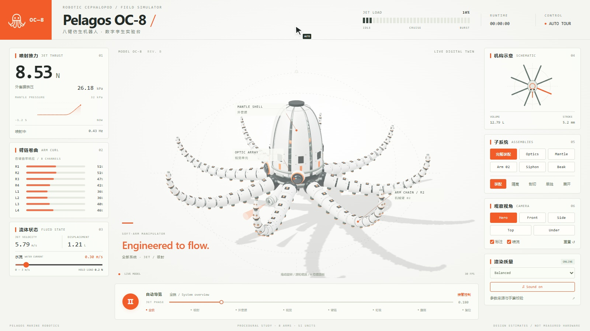
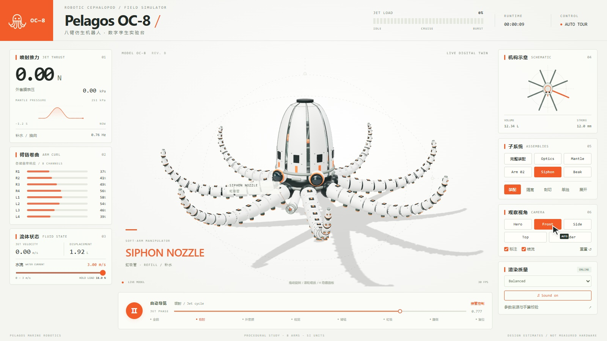
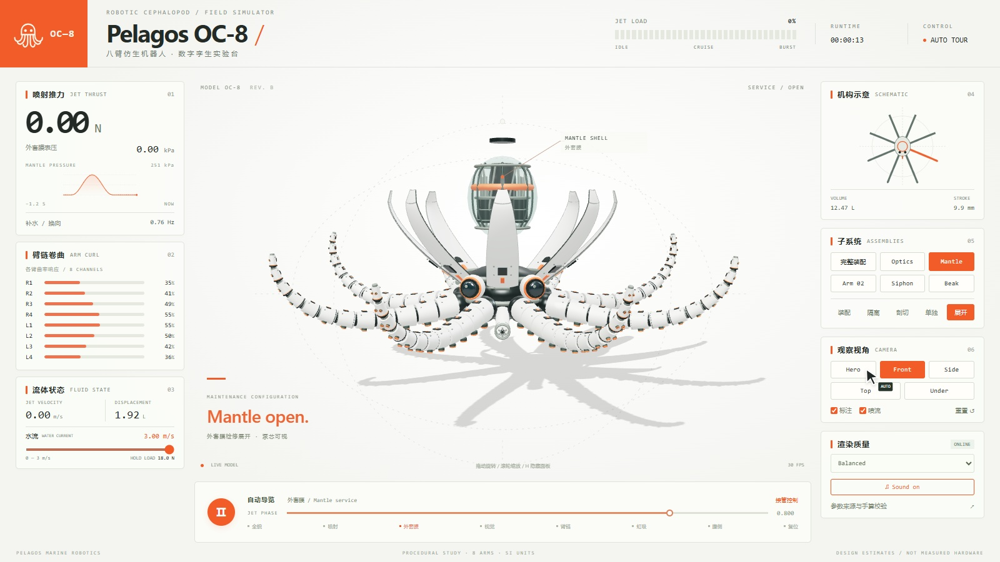
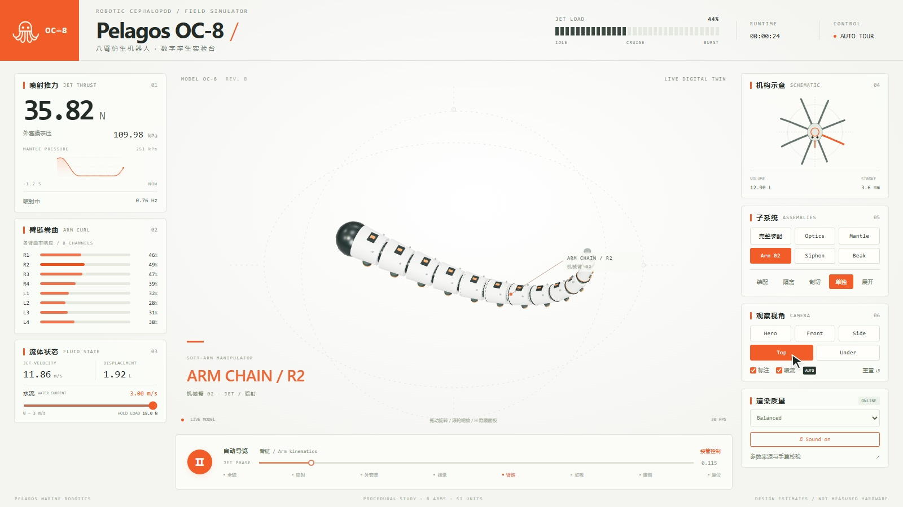
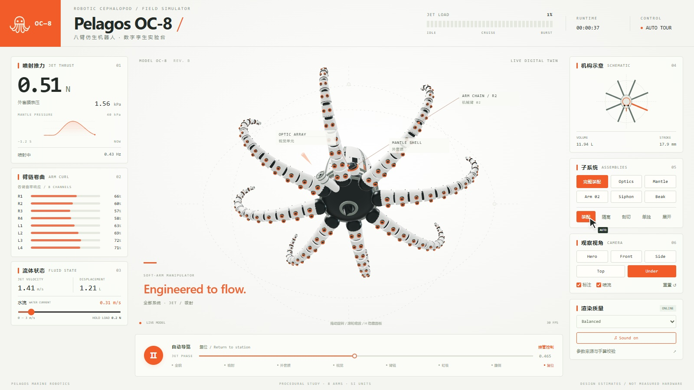

# Pelagos OC-8

[English](README.md) | **中文**

[](https://github.com/5758703/robotic_Pelagos_oc_8/stargazers)
[](LICENSE)
[](https://vuejs.org/)
[](https://threejs.org/)
[](https://vitejs.dev/)

Vue + Vite + Three.js 机械八爪鱼数字孪生展示。  
所有物理参数均为 **设计估算 / my guess**，没有真实设备遥测接入。

<p align="center">
  
</p>

---

## 演示影片

约 40 秒带配乐控制台导览 · 1600×900 · 30 FPS · 母带约 −14 LUFS。

### 带声影片

<video src="artifacts/film/Pelagos_OC8_scored.mp4" controls width="860" poster="artifacts/film/frame-0.jpg">
  当前环境无法内嵌播放，请
  <a href="artifacts/film/Pelagos_OC8_scored.mp4">下载 Pelagos_OC8_scored.mp4</a>
</video>

[▶ 打开带声 MP4](artifacts/film/Pelagos_OC8_scored.mp4) · [无声导览 MP4](artifacts/film/tour-silent.mp4)

### 关键帧

| t ≈ 0 s | t ≈ 9 s | t ≈ 13 s |
|:---:|:---:|:---:|
|  |  |  |

| t ≈ 24 s | t ≈ 37 s |
|:---:|:---:|
|  |  |

解码 AAC 实测：**−14.01 LUFS** 综合响度，**−1.30 dBTP** 真峰值 · 共 1,200 帧 · 详见 [`artifacts/film/loudness-report.json`](artifacts/film/loudness-report.json)。

---

## 功能概览

- 单一纯函数物理源（`stateAt` / `armPoints`），三维、遥测、压力历史与示意共用
- 水流滑块 0–3 m/s，前馈站位保持估算
- 可选程序化环境配乐（Enable sound）
- 自动导览点击真实按钮；用户输入立即接管，静置 25 秒恢复
- 子系统隔离 / 剖切 / 单独 / 检修展开
- Studio / Balanced / Integrated GPU 三档画质
- 同源装配导出驱动的 Blender 工程

---

## 快速开始

```powershell
npm install --cache .tools/npm-cache
npm run dev -- --port 5173
```

浏览器打开 http://127.0.0.1:5173/ 。`npm run build` 输出至 `dist/`。

### 操作

| 输入 | 作用 |
| --- | --- |
| 拖动 | 旋转视角 |
| 滚轮 | 缩放 |
| `H` | 隐藏 / 显示面板 |
| 空格 | 播放 / 暂停 |
| 相位滑块 | 检查任意姿态（会暂停物理循环） |
| 流速滑块 | 0–3 m/s 流体负载 |
| Enable sound | 开启实时程序化配乐 |

---

## 单一物理模型

`src/model.js` 的 `stateAt(phase, current)` 为全部物理读数的唯一来源，`armPoints(index, phase, current)` 生成关节位置。压力历史重新采样同一函数，没有独立图表动画。

`src/parameters.json` 保存 SI 参数及来源声明。基线估算：周期 2.4 s、排量 1.2 L、喷口直径 18 mm、密度 1000 kg/m³、Cd = 0.8。

在 p = 0.25（零流速）：Q ≈ 1.571 L/s，v ≈ 6.173 m/s，P ≈ 29.77 kPa，F ≈ 9.696 N。后半周期补水，喷射推力为零。半周期流量积分为 1.2 L。

流速阻力 D = ½ρCdAu²（A = 0.008 m²，Cd = 0.5，均为估算）。3 m/s 时 D ≈ 18 N，峰值喷射约 81.7 N，脉冲约 0.756 Hz。详见 [`docs/current-and-score.md`](docs/current-and-score.md)。

`machine.js` 保存可编辑装配；`batching.js` 仅建立 GPU 实例化绘制副本。变换仍来自原始结构。

---

## Blender 源文件

打开 `blender/Pelagos_OC8.blend`，选中根对象 `Pelagos_OC8`：

- `jet_phase`：唯一物理输入；时间线第 1–145 帧以 60 FPS 对应一个周期
- `service_open`：检修展开量，不参与喷射物理
- 原生短表达式驱动器连接机械臂、外套膜、泵芯、镜头及阀门；不依赖自动执行外部 Python

重新生成（本项目 `.tools` 中已准备便携 Blender）：

```powershell
npm run export:blender
& '.\.tools\blender-4.5.3-windows-x64\blender.exe' --background --python blender/build_scene.py
& '.\.tools\blender-4.5.3-windows-x64\blender.exe' --background blender/Pelagos_OC8.blend --python blender/validate_scene.py
```

官方运行包：[Blender 4.5 下载目录](https://download.blender.org/release/Blender4.5/)。

---

## 影片与音频流水线

需先启动 Vite 服务：

```powershell
node scripts/render-film.mjs
node scripts/render-score.mjs
python scripts/master-film.py
```

| 产物 | 说明 |
| --- | --- |
| `artifacts/film/tour-silent.mp4` | 无声确定性导览 |
| `artifacts/film/Pelagos_OC8_scored.mp4` | 最终合成影片（AAC） |
| `artifacts/film/frame-*.jpg` | 关键采样帧 |
| `artifacts/film/timeline.json` | 按钮 / 喷射事件轨迹 |
| `artifacts/film/loudness-report.json` | Loudnorm 实测 |

目标：−14 LUFS 综合响度，真峰值上限 −1.5 dBTP（解码后验收 &lt; −1 dBTP）。

---

## 检查

```powershell
npm test
npm run qa
node scripts/review-regressions.mjs
python scripts/contact-sheet.py
```

浏览器检查使用本机 Chrome，运行前保留 Vite 服务。见 [`docs/verification.md`](docs/verification.md)、[`artifacts/qa-results.json`](artifacts/qa-results.json)、[`artifacts/blender-validation.json`](artifacts/blender-validation.json)。

碰撞扫描覆盖 0 / 0.3 / 1.5 / 3 m/s 下 40 个相位。完整套件：**15** 项测试通过。

---

## 文件组织

```
src/          控制台、镜头、物理、装配、导览、配乐、影片
blender/      源文件与生成 / 验证脚本
scripts/      影片渲染、配乐、QA、Blender 导出
tests/        守恒、关节、碰撞、流速、配乐
artifacts/    QA 与影片交付物
docs/         验证与流速 / 配乐说明
```

---

## 验证范围

这是可交互的机构研究模型，并非经 CFD、结构计算或水下实验校准的工程数字孪生。碰撞检查针对采样相位、关节连接和机械臂保守包络，不能视为全部零件的制造公差认证。检修展开是展示变换，不代表真实设备可开壳运行。

---

## Star 趋势

[](https://www.star-history.com/#5758703/robotic_Pelagos_oc_8&Date)

[](https://starchart.cc/5758703/robotic_Pelagos_oc_8)

---

## 链接

- 仓库：https://github.com/5758703/robotic_Pelagos_oc_8
- [English README](README.md)
- [流速与配乐导览](docs/current-and-score.md)
- [验证说明](docs/verification.md)
